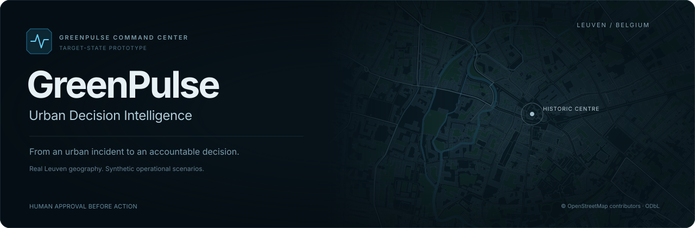
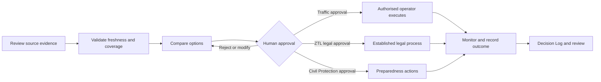

<div align="center">



**Three municipal workflows. One accountable decision capability.**

[**Open the demo**](https://greenpulse-urban-intelligence.kmateva.chatgpt.site) · [GitHub Pages](https://queenkm.github.io/greenpulse-smart-city/) · [Presentation guide](docs/PRESENTATION-GUIDE.md) · [Quick start](#quick-start)

[](https://github.com/QueenKM/greenpulse-smart-city/actions/workflows/deploy.yml)
[](https://react.dev/)
[](https://vite.dev/)

<sub>Project artwork uses Leuven OpenStreetMap geometry; it is not an application screenshot.</sub>

</div>

> [!IMPORTANT]
> **TARGET-STATE PROTOTYPE · SYNTHETIC DEMONSTRATION DATA**
>
> Real Leuven geography provides spatial context only. Operational data, incidents, sensor placements and scenarios are synthetic. No municipal systems are connected. GreenPulse describes a capability to implement progressively after data validation.

## The three workflows

| Workflow | Evidence and purpose | Human authority |
| :-- | :-- | :-- |
| **Daily Traffic Management** | Review counts and queue patterns at monitored locations, using the reference inventory of 18 cameras, 4 vehicle loops, 4 controllers, 21 ITS panels and GIS. Support targeted, time-limited operations. | Mobility Department approves; an authorised traffic-signal operator executes. Municipal Police and IT / Digital Office support. |
| **ZTL / Historic-Centre Access Management** | Compare aggregate entry patterns by gate and period, using 10 ZTL gates, 16 OCR cameras and GIS. Police and permit records require lawful, technically validated access. | Municipal Police leads operational/legal action, with Mobility, IT / Data Office and an authorised privacy lead. |
| **Heatwave Preparedness** | Use official external forecasts, demographic registry, GIS, partial tree/green-space inventory and civil-protection plans for indicative priorities and coordinated preparedness. | Civil Protection approves / activates; Environment / Urban Planning interprets environmental evidence; Social Services coordinates outreach. |

The reviewed **CURRENT FINAL version-3.pptx** presentation (18 slides) takes precedence over earlier working documents. Its benchmark assessment covers **Trikala, Venice, Pavia and Leuven**; these precedents inform transferability, not GreenPulse performance. See [document integration](docs/DOCUMENT-INTEGRATION.md) for slide traceability and the implementation contract.

### Boundaries that stay visible

- **Traffic:** corridor travel time is a conditional pilot KPI. Camera/OCR timestamp linkage must be validated first; until then, counts and queue patterns do not establish network-wide congestion coverage.
- **ZTL:** entries are not automatically violations. Compliance requires validated permit/exemption linkage. No identifiable licence plates appear in the prototype and no rule changes happen automatically.
- **Heat:** no local temperature/humidity sensing network, validated cooling-point inventory or real-time health/exposure feed is documented. Local heat-priority maps are indicative/modelled; green-space distribution does not prove cooling.
- **Outcomes:** estimated CO₂, measured air quality, modelled scenarios and observed outcomes are distinct. Traffic improvement does not automatically prove an air-quality or causal emissions benefit.

## The seven-KPI framework

| KPI | Definition | Readiness |
| :-- | :-- | :-- |
| **K1** | Pilot corridor travel time and delay | **PILOT** — subject to validated timestamp linkage between selected camera/OCR monitoring points. |
| **K2** | Estimated tailpipe CO₂ avoided | **TARGET · ESTIMATED** — requires validated K1 and approved emission factors. |
| **K3** | Measured NO₂ and PM2.5 | **TARGET · MEASURED** type — requires ARPA integration and/or new validated sensors; no feed is connected. |
| **K4** | Alert-to-decision time | **PILOT-READY** through the decision log; “under 10 minutes” is an illustrative pilot target. |
| **K5** | Heat exposure in person-hours | **TARGET** — requires validated local heat sensing. |
| **K6** | Vulnerable residents within reach of cooling points | **PILOT** — requires a validated inventory and a pilot-defined walking-time or network-distance threshold. |
| **K7** | Decisions fully recorded | **PILOT-READY** through the decision log; target **100%** complete logging, not decision quality. |

Missing inputs return **No data**, never zero. Each relevant value carries its provenance: CURRENT, PILOT, TARGET, MEASURED, ESTIMATED, MODELLED, SYNTHETIC or NO DATA.

The traffic calculation example uses **18.0 minutes → 16.2 minutes = 10% illustrative improvement**.

> Illustrative values used to demonstrate the KPI calculation. The real baseline will be established during pilot preparation.

18.0 minutes is not a measured municipal baseline; 16.2 minutes is not an achieved result. Formula details and dependencies are in [KPI methodology](docs/KPI-METHODOLOGY.md).

## Decisions remain human



**AI recommends; it never executes autonomously.** Traffic approval and authorised execution are separate actions. The Decision Log retains approvals, rejections, modifications and executions. Completing an accelerated review window does not invent a successful measured outcome.

## Architecture and delivery

**Sources → Integration → Urban Data Hub → Analytics / Selective Digital Twin → Action & Evidence**

> Target-state architecture, implemented progressively after data validation.

| Period | Stage | Focus |
| :-- | :-- | :-- |
| **0–6 months** | **Discover & Prepare** | Validate source access, authority, privacy, timestamp linkage, pilot baselines and cooling inventory. |
| **6–18 months** | **Integrate & Pilot** | Integrate validated priority sources and run controlled workflows with complete decision logging. |
| **18–36 months** | **Extend Selectively** | Extend only where evidence supports it; introduce selective models and environmental KPIs after validation. |

Prediction, Digital Twin simulation, new environmental sensors and full KPI coverage are target capabilities. Dates do not bypass evidence, safety or legal gates. See [Governance & Roadmap](docs/GOVERNANCE-ROADMAP.md).

## Explore the prototype

The main navigation follows the final scope: **Overview · Daily Traffic · ZTL Access · Heat Preparedness · Architecture · KPI Framework · Decision Log · Governance & Roadmap · Presentation Demo**.

The map keeps real Leuven streets, building footprints, green spaces and waterways. **CURRENT / MVP / TARGET** communicates maturity; **Layers** reveals overlays. The sidebar expands on hover or keyboard focus and uses a menu button on mobile. A guided presentation supports the decision narrative without bypassing approval or execution. View preferences survive navigation. Approvals and the Decision Log belong to the current browser demonstration session; refreshing or resetting clears them. Proposed role selection demonstrates accountability rather than authenticating a municipal official.

The clock displays the actual date and time in **Europe/Sofia**, including daylight-saving adjustments. Synthetic scenarios use a separate demonstration context.

## Quick start

Requires **Node.js 22+** and npm.

```bash
git clone https://github.com/QueenKM/greenpulse-smart-city.git
cd greenpulse-smart-city
npm ci
npm run dev
```

Open the Vite URL with the `/greenpulse-smart-city/` base, normally **http://localhost:5173/greenpulse-smart-city/**.

| Command | Purpose |
| :-- | :-- |
| `npm test` | Run calculation, human-authority, lifecycle, provenance and interface checks. |
| `npm run build` | Create the GitHub Pages production build in `dist/`. |
| `npm run preview` | Preview that build locally. |

React, Vite, Framer Motion, Recharts and Lucide React support the interface. Typography and geographic data are bundled locally; the map does not require an external tile server for a presentation. Vite uses `base: "/greenpulse-smart-city/"` for GitHub Pages; the managed Site build uses its root path.

## Geography and source notice

Every map retains:

> **LEUVEN URBAN MODEL**<br />
> Illustrative operational scenario<br />
> Synthetic demonstration data

Geography: [© OpenStreetMap contributors](https://www.openstreetmap.org/copyright), [ODbL 1.0](https://opendatacommons.org/licenses/odbl/1-0/). Heights are shown only where mapped height data exists; no invented measured building heights are added. Heritage shapes are reference context rather than authoritative legal boundaries. Demonstration sensors and cooling placements are not a validated municipal inventory.

[Geographic extract](https://queenkm.github.io/greenpulse-smart-city/data/leuven-urban-model.json) · [Source geometry](src/data/city-model.json) · [Data notice](public/data/NOTICE.txt)

To regenerate the snapshot from a local OSM XML extract:

```bash
python scripts/build-city-model.py /path/to/leuven-osm.xml
```

The derivative geographic database retains its ODbL notice separately from application code. The original slide deck, source reports and personal upload metadata are not published in this repository.

## Submission material

This repository provides the runnable prototype, methodology and governance notes, reproducible capture automation and five final presentation PNGs. The reviewed presentation and original research reports remain separate course-delivery material; their entries in Evidence are provenance metadata, not downloadable annexes. Submit or link the authorised presentation and research annexes separately when handing in the full academic project.

The presentation's infrastructure reality check also documents **5 paid-parking sensors**, with data unavailable until the supplier contract is finalised, and locates the **4 vehicle-counting loops at 3 public parking areas**. These are source-inventory facts to validate, not connected prototype feeds.

## Supporting material

- [KPI definitions, formulas and readiness](docs/KPI-METHODOLOGY.md)
- [Governance, authority and roadmap](docs/GOVERNANCE-ROADMAP.md)
- [15-minute presentation guide](docs/PRESENTATION-GUIDE.md)
- [Reviewed presentation alignment and source traceability](docs/DOCUMENT-INTEGRATION.md)
- [Presentation screenshot setup and capture guide](docs/PRESENTATION-SCREENSHOTS.md)
- [Five final presentation screenshots](docs/presentation-assets/)
