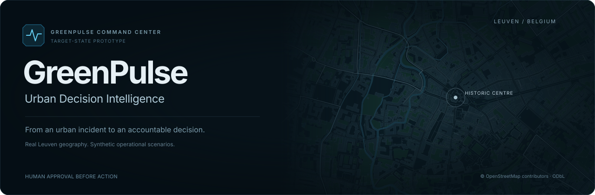
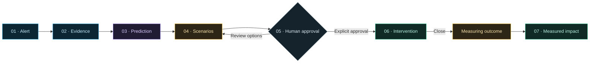

<div align="center">



**A map-led smart-city command center, built around accountable human decisions.**

[**Open the live demo**](https://greenpulse-urban-intelligence.kmateva.chatgpt.site) · [GitHub Pages](https://queenkm.github.io/greenpulse-smart-city/) · [Presentation guide](docs/PRESENTATION-GUIDE.md) · [Quick start](#quick-start)

[](https://github.com/QueenKM/greenpulse-smart-city/actions/workflows/deploy.yml)
[](https://react.dev/)
[](https://vite.dev/)

<sub>Project artwork based on Leuven OpenStreetMap geometry; not an application screenshot.</sub>

</div>

<br />

> [!IMPORTANT]
> **TARGET-STATE PROTOTYPE · SYNTHETIC DEMONSTRATION DATA**
>
> Leuven's street and building geometry is real. Incidents, sensor locations, traffic, air quality, heat zones, forecasts and outcomes are synthetic. GreenPulse is a proposed operating model, with no municipal systems connected.

## The idea

GreenPulse connects an urban incident to a decision: **what is happening, what might happen next, which options exist, who authorises the response, and how its outcome would be evaluated.**

The prototype brings traffic, air quality and urban heat into one operational story. Its maturity journey makes the proposal explicit:

**Current inventory → MVP → Capability development → GreenPulse target state**

## Explore the experience

| Capability                      | What you can do                                                                                                                                       |
| :------------------------------ | :---------------------------------------------------------------------------------------------------------------------------------------------------- |
| **City operations**             | Explore real Leuven streets, buildings, parks and waterways. Select H-03 to focus its affected corridors; switch map layers and 2D/3D views.          |
| **Shared forecast timeline**    | Move between **Now / +15 / +30 / +60 min** across the map, traffic chart and scenario comparison.                                                     |
| **Scenario intelligence**       | Compare doing nothing, adaptive signals and traffic diversion. Use a synced before/after camera and inspect the trade-offs behind the recommendation. |
| **Human-led intervention**      | Review, modify and explicitly approve an action. Pause, hand over and close it, with an accountable operator and demonstration decision log.          |
| **KPI & impact**                | Compare predicted and synthetic observed improvements; open the calculation, baseline and assumptions behind the numbers.                             |
| **Implementation & governance** | Follow the maturity roadmap and inspect proposed owners, data stewards, decision authority, dependencies and phase gates.                             |

### One incident. A complete decision journey.



**AI recommends; an identified human authorises.** No demo control or keyboard shortcut can bypass approval. Closing an intervention starts measurement; it does not immediately report success.

## Try the presentation

1. Open either [live demo](https://greenpulse-urban-intelligence.kmateva.chatgpt.site) or [GitHub Pages](https://queenkm.github.io/greenpulse-smart-city/).
2. Select **Presentation Demo**. The app prepares its geographic views and requests fullscreen.
3. Follow **Next Step** through the evidence, forecast and scenarios.
4. At the approval drawer, choose **Approve & Activate** explicitly.
5. Demonstrate **Pause / Resume**, **Handover**, then **Close Intervention** to begin the synthetic measurement replay.

| Control                | Behaviour                                                                                                                |
| :--------------------- | :----------------------------------------------------------------------------------------------------------------------- |
| **← / →**              | Previous / next presentation step. Inputs, comparison controls and approval dialogs retain their own keyboard behaviour. |
| **Esc**                | Close the active dialog, or exit presentation when no dialog is open.                                                    |
| **Fullscreen control** | Enter / leave fullscreen. If the browser declines it, the guided in-page mode remains available.                         |
| **Reset Demo**         | Start a fresh synthetic decision cycle. The real wall clock keeps running.                                               |

<details>
<summary><strong>Replay timing and comparison details</strong></summary>

- The five-second measuring phase represents an accelerated **60-minute observation window**.
- The default active timer starts at **00:47:32** in the 60-minute replay. Modified operating windows start at their full duration; expiry pauses for human review.
- The actual clock uses **Europe/Sofia**, updates every second and adjusts for summer/winter time. Forecast views share a synthetic snapshot anchor.
- **Pan both maps** moves the comparison camera; **Drag comparison** restores the before/after divider.
- **City Control Room ▾** opens workspace shortcuts, including the map, scenarios, roadmap and presentation.
- The desktop sidebar rests as an icon rail. Hover to expand it; moving away hides the labels without shifting the city view. Keyboard focus keeps navigation open, and mobile uses the menu button.
- **CURRENT / MVP / TARGET** changes the map: reference geography → a proposed priority corridor → the integrated target-state model with mapped-height 3D. These are illustrative capability stages, not a verified inventory of Leuven's deployed systems.
- **Layers** opens the individual overlay controls. Availability follows the selected maturity stage; your layer preferences are preserved when switching stages.

</details>

## Method, evidence & presentation materials

| Read                                                           | Purpose                                                                                                   |
| :------------------------------------------------------------- | :-------------------------------------------------------------------------------------------------------- |
| [**KPI methodology**](docs/KPI-METHODOLOGY.md)                 | Definitions, worked calculations, baselines, causal reasoning, assumptions and verification requirements. |
| [**Governance roadmap**](docs/GOVERNANCE-ROADMAP.md)           | Proposed RACI, accountable owners, operating responsibilities and implementation gates.                   |
| [**15-minute presentation guide**](docs/PRESENTATION-GUIDE.md) | A timed method-and-results narrative, demonstration script and references for the final slide.            |

**Inside the app:** use **KPI & Impact → KPI calculation & assumptions**, **Digital Twin → How is this calculated?**, or select a roadmap phase to inspect its proposed governance.

> [!NOTE]
> The **+60-minute scenario comparison** and the **closed-loop impact benchmark** are separate synthetic examples with different comparators. Their percentages must not be combined or described as one calibrated causal simulation. The arithmetic is reproducible; the forecast assumptions and effects are unvalidated.

## Quick start

**Requires Node.js 22+ and npm.**

```bash
git clone https://github.com/QueenKM/greenpulse-smart-city.git
cd greenpulse-smart-city
npm ci
npm run dev
```

Open Vite's local URL with the `/greenpulse-smart-city/` base path — normally **http://localhost:5173/greenpulse-smart-city/**.

| Command           | Purpose                                             |
| :---------------- | :-------------------------------------------------- |
| `npm test`        | Run lifecycle, forecast and DOM interaction checks. |
| `npm run build`   | Create the production build in `dist/`.             |
| `npm run preview` | Serve the production build locally.                 |

Typography and geographic data are bundled locally; maps do not depend on an external tile server during a presentation.

## Geography & data provenance

Every map persistently displays:

> **LEUVEN URBAN MODEL**<br />
> Illustrative operational scenario<br />
> Synthetic demonstration data

The geographic snapshot contains real central Leuven street hierarchy, pedestrian routes, building footprints, green spaces and waterways. Source: [© OpenStreetMap contributors](https://www.openstreetmap.org/copyright), under [ODbL 1.0](https://opendatacommons.org/licenses/odbl/1-0/).

- Only explicit mapped heights produce 3D building extrusions. Missing heights remain flat footprints; floor counts are not converted into invented measured heights.
- Historic features are mapped reference sites, not authoritative legal protection boundaries.
- Sensors and cooling points are proposed demonstration placements, not a verified municipal inventory.
- The prototype is neither a surveyed city model nor a calibrated digital twin.

[Download the geographic extract](https://queenkm.github.io/greenpulse-smart-city/data/leuven-urban-model.json) · [Inspect the source database](src/data/city-model.json) · [Data notice](public/data/NOTICE.txt)

<details>
<summary><strong>Regenerate the geographic snapshot</strong></summary>

Use a local OSM API XML extract covering the documented bounding box:

```bash
python scripts/build-city-model.py /path/to/leuven-osm.xml
```

Source feature identifiers are retained. The derivative geographic database remains **ODbL 1.0**; it is separate from the application code.

</details>

### Reading the operational colours

| Signal                                     | Meaning                                                     |
| :----------------------------------------- | :---------------------------------------------------------- |
| **Cyan · LIVE**                            | Current synthetic operational replay.                       |
| **Purple · MODELLED**                      | Forecasts and AI-supported decision intelligence.           |
| **Amber · SIMULATED**                      | Intervention scenarios and warnings.                        |
| **Emerald · APPROVED / ACTIVE / MEASURED** | Approved actions and completed synthetic positive outcomes. |
| **Rose · CRITICAL**                        | High-priority operational conditions.                       |

<details>
<summary><strong>Why does Data Health show 14 / 17 operational feeds?</strong></summary>

The synthetic inventory contains seven traffic, two air-quality, four parking, two AVL, one weather and one visitor-flow feed: **17 in total**. T18 maintenance, AQ-07 offline and delayed Visitor Flow account for the three exclusions. Historic GIS is reference data and is excluded from the operational-feed count.

</details>

## For developers

**Stack:** React · Vite · Framer Motion · Recharts · Lucide React.

| Location                                 | Responsibility                                                                 |
| :--------------------------------------- | :----------------------------------------------------------------------------- |
| [`src/App.jsx`](src/App.jsx)             | Persistent shell, Overview and presentation coordination.                      |
| [`src/lifecycle.mjs`](src/lifecycle.mjs) | Human approval, intervention ownership and measurement gates.                  |
| [`src/scenario.mjs`](src/scenario.mjs)   | Shared synthetic forecast assumptions and decision-score weights.              |
| [`src/components/`](src/components/)     | Geographic renderer, synced comparison, charts, panels and accessible drawers. |
| [`tests/`](tests/)                       | Lifecycle, scoring and DOM interaction checks.                                 |
| [`docs/`](docs/)                         | Methodology, governance and presentation annexes.                              |

### Deployment

**GitHub Pages:** the default Vite base is `/greenpulse-smart-city/`. The [Actions workflow](.github/workflows/deploy.yml) installs from the lockfile, tests and builds pull requests, and deploys successful pushes to `main`. Pull requests do not deploy.

**Root-path Sites hosting:**

```bash
SITES_BUILD=1 npm run build
```

This produces root-relative assets while preserving the default GitHub Pages configuration.

### Verification & limits

Production builds, lifecycle rules and DOM interactions are checked automatically. Motion is replaced by a deterministic adapter in DOM tests, and fullscreen checks use a DOM API adapter. These checks do not establish browser layout, animation quality or native fullscreen behaviour; a visual browser review is still needed before a live presentation.

Scenario scores, model confidence and intervention effects are illustrative assumptions. Tartu, Leuven and Pavia benchmark themes are design interpretations, not claims of equivalent municipal capability. Modified intervention parameters are recorded, while the closed-loop benchmark values remain fixed synthetic fixtures.

---

<div align="center">

**A city in context. A decision with an owner.**

[Open GreenPulse](https://greenpulse-urban-intelligence.kmateva.chatgpt.site) · [Read the methodology](docs/KPI-METHODOLOGY.md) · [Follow the roadmap](docs/GOVERNANCE-ROADMAP.md)

</div>
